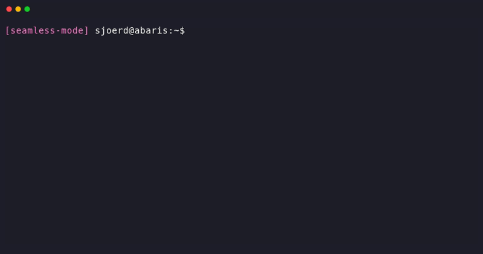

# Seamless

**Seamless: define your computation once — cache it, scale it, share it.**

Most computational pipelines are already reproducible — the same inputs produce the same outputs. Wrap your code as a step with declared inputs and outputs, and Seamless gives you caching (never recompute what you've already computed) and remote deployment (run on a cluster without changing your code). Remote execution also acts as a reproducibility test: if your wrapped code runs on a clean worker and produces the same result, it is reproducible. If not, Seamless has helped you find the problem — whether it's a missing input, an undeclared dependency, or a sensitivity to platform or library versions.

Every step becomes a *transformation*, identified by the checksum of its code and inputs: identical work always has the same identity, whoever runs it and wherever.

**Seamless 1.5 (pre-release)** is the first 1.x version on feature parity with legacy Seamless 0.x. The interactive workflow layer is back, on the new architecture: reactive cells, file mounts, Jupyter widgets and web interfaces over HTTP. Not carried over are macros, the standard library, Silk validation and sub-contexts. See the [release notes](https://github.com/sjdv1982/seamless/blob/main/RELEASE-NOTES.md).

## Three faces

Seamless has three entry points, or *faces*. You can start with any of them and combine them later. They share one cache, because all three produce the same kind of transformation.

- **Python face**: `direct` runs a function immediately; `delayed` records it for deferred or remote execution. Your program stays in charge.
- **Command-line face**: `seamless-run` wraps any shell command. No Python required.
- **Workflow face**: a `Context` is a reactive graph of cells and transformers, kept up to date as values change. Cells can be mounted to files, linked to Jupyter widgets, or served over HTTP.

Transformers can be written in Python, bash, R, Julia or a compiled language (C, C++, Fortran, Rust). R, Julia and compiled code go through `Transformer(...)`, in Python or in a Context.

### Python face: `direct`

```python
from seamless.transformer import direct

@direct
def add(a, b):
    return a + b

add(2, 3)   # runs the function, returns 5
add(2, 3)   # cache hit — returns 5 instantly
```

### Command-line face: `seamless-run`

```bash
export SEAMLESS_CACHE=~/.seamless/cache     # global persistent caching

seamless-run 'seq 1 10 | tac && sleep 5'    # runs, caches result
seamless-run 'seq 1 10 | tac && sleep 5'    # cache hit — instant
```

### Workflow face: `Context`

```python
from seamless.workflow import Context

def add(a, b):
    return a + b

ctx = Context()
ctx.a = 10
ctx.b = 20
ctx.add = add
ctx.add.pins.a = ctx.a
ctx.add.pins.b = ctx.b
ctx.c = ctx.add.result
ctx.compute()
print(ctx.c.value)          # 30

ctx.a.mount("a.json")       # edit a.json, and c follows
ctx.c.share()               # http://localhost:5813/ctx/c (no authentication)
```

## What makes Seamless different

Seamless is not the only tool that caches computations by content. What sets it apart is how it treats determinism: as a scientific claim that can be tested, rather than something guaranteed by a closed language or enforced by a sandbox.

- **A result is a claim that can be tested.** "This transformation yields this result" is meant to hold wherever it is computed. The execution environment is deliberately *not* part of a transformation's identity, so recomputing a step on another machine, with other library versions, is a replication of the same computation, not a different one. When a recomputation gives a different result, the database keeps the original and records the divergence.
- **Checksums are first-class.** A checksum can stand in for the data it identifies: a computation over a checksum has the same identity as the computation over the data itself. Identity is independent of where the data is stored, or whether it is present locally.
- **Results have identities, not just recipes.** Downstream steps are keyed on the results they consume. If an upstream edit leaves a result unchanged, nothing downstream reruns.
- **Any file has an identity.** Identity is the SHA-256 of the bytes, verifiable with standard tools. Types interpret data; they don't require converting it into a Seamless format first.

Together, these let a result travel between machines, labs and publications with its identity intact: a portable scientific fact that others can build on or replicate. The trade-off is deliberate. Seamless is for deterministic computation; it is not designed for workflows whose purpose is side effects, such as sending notifications or querying live services. For the full argument, and how this compares to Make, Snakemake, Bazel, Nix and Unison, see the [positioning paper](https://github.com/sjdv1982/seamless/blob/main/positioning-paper.md).

## Sharing results

The lightweight way is to exchange checksums: if two researchers have computed the same transformation, they already have the same result, so no data needs to be transferred. The concrete way is to share the `seamless.db` file, a portable SQLite database that maps transformation checksums to result checksums. Copy it to a colleague, a cluster or a publication archive, and every cached result travels with it.

## Installation

```bash
pip install seamless-suite
```

This installs all standard Seamless components, including Jupyter widget and HTTP share support. The core user-facing packages are:

| Package | Import | Provides |
| --- | --- | --- |
| `seamless-core` | `import seamless` | `Checksum`, `Buffer`, `Cell`, `Expression`, celltypes, buffer cache |
| `seamless-transformer` | `from seamless.transformer import Transformer, direct, delayed` | `Transformer`, `direct`, `delayed`, `parallel`, `parallel_async`, `TransformationList`, `seamless-run`, `seamless-upload`, `seamless-download`, `seamless-cancel` |
| `seamless-workflow` | `from seamless.workflow import Context, Cell, Transformer` | reactive Contexts, file mounts, Jupyter widgets, HTTP shares, `seamless-serve-graph` |
| `seamless-config` | `import seamless.config` | `seamless.config.init()`, `seamless.config.set_nparallel()`, `seamless-init` |

R and Julia transformers need their own runtimes (`Rscript`, `julia`); see the [setup notes](https://github.com/sjdv1982/seamless/blob/main/docs/main/r-and-julia-transformers.md). The Julia command-line backend currently requires a source checkout.

## Seamless mode

When `seamless-suite` is installed in a Conda environment, activating that environment in interactive Bash loads the Seamless mode bindings automatically. For POSIX venvs, including uv environments, run `seamless-mode-venv-hook install` once after activating the environment. In Pixi, use `pixi run seamless-mode-shell`. Use `seamless-mode-on` and `seamless-mode-off` to enable and disable Seamless mode; `Ctrl-U U` toggles it. See the [Seamless mode setup guide](https://sjdv1982.github.io/seamless/seamless-mode.html#setup).

### Automatically wrap the bash commands you type



## Documentation

The documentation at **<https://sjdv1982.github.io/seamless/>** covers the Python and command-line faces: getting started, caching, cluster setup, remote execution, compiled transformers and the reference API.

The workflow face has no guide yet. Start with the [examples](https://github.com/sjdv1982/seamless-workflow/tree/main/examples) (`basic-example.ipynb` first). The precise behaviour of every feature is specified in the [contract pages](https://github.com/sjdv1982/seamless/tree/main/docs/agent/contracts). They are written for AI agents, but readable; for the workflow face, start with `workflow-context.md`, `cells.md`, `mounts.md`, `shares.md` and `widgets.md`.

For changes, see the [release notes](https://github.com/sjdv1982/seamless/blob/main/RELEASE-NOTES.md) and, in more detail, the [changelog](https://github.com/sjdv1982/seamless/blob/main/CHANGELOG.md).

## Agent skills

Seamless includes [skills](https://github.com/sjdv1982/seamless/tree/main/skills) for AI coding assistants:

- `seamless-adoption`: assess whether a codebase fits Seamless, and plan a port.
- `seamless-porting`: carry out a port, or upgrade from Seamless 0.x or 1.4.
- `seamless-workflow`: build, run and debug a reactive workflow `Context` (cells, mounts, shares, widgets).
- `seamless-remote-debugging`: debug remote execution (hashserver, database, jobserver, daskserver).

## Source code

All source code is on GitHub: [seamless-core](https://github.com/sjdv1982/seamless-core), [seamless-transformer](https://github.com/sjdv1982/seamless-transformer), [seamless-workflow](https://github.com/sjdv1982/seamless-workflow), [seamless-config](https://github.com/sjdv1982/seamless-config), [seamless-remote](https://github.com/sjdv1982/seamless-remote), [seamless-database](https://github.com/sjdv1982/seamless-database), [hashserver](https://github.com/sjdv1982/hashserver), [seamless-jobserver](https://github.com/sjdv1982/seamless-jobserver), [seamless-dask](https://github.com/sjdv1982/seamless-dask), [seamless-signature](https://github.com/sjdv1982/seamless-signature), [remote-http-launcher](https://github.com/sjdv1982/remote-http-launcher)

The previous, 0.x version is documented at [legacy](https://sjdv1982.github.io/seamless/legacy/).
